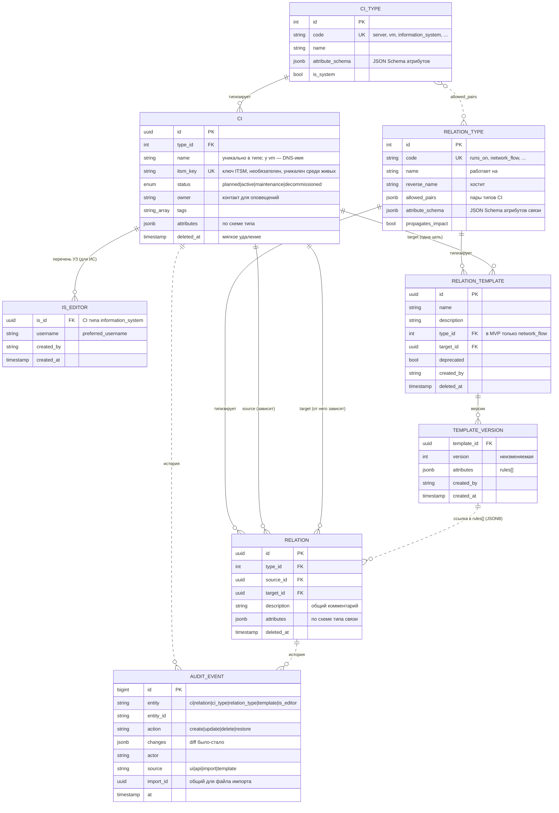
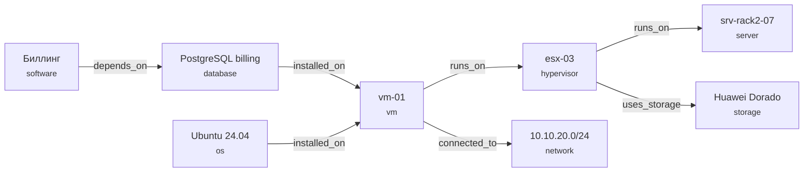

# CMDB — требования (MVP)

Статус: черновик v0.2 · 2026-10-10 · решения сценариев — в [scenarios.md](scenarios.md)

## 1. Цель

Единый источник правды об ИТ-инфраструктуре: какие конфигурационные единицы (CI) есть —
серверы, ВМ, сетевые устройства, сети, ПО — и как они связаны между собой. Основной вопрос,
на который отвечает система: **«что сломается, если выключить X?»** Второй вопрос: **«в какую
информационную систему (ИС) входит CI и с кем она взаимодействует по сети?»**

## 2. Границы MVP

Входит:
- учёт CI с настраиваемыми типами и атрибутами;
- информационные системы (ИС) как отдельный тип CI; каждый CI входит ровно в одну ИС;
- связи между CI с атрибутами; сетевые взаимодействия между ВМ (протокол, порт, описание);
- граф зависимостей с анализом влияния;
- шаблоны сетевых взаимодействий с версиями и массовым применением;
- ручное наполнение через веб-UI и REST API;
- импорт из CSV/XLSX двух видов — ВМ и сетевых взаимодействий; экспорт в CSV/XLSX;
- API для внешних систем: ИС по CI, поиск CI по DNS-имени/IP/ключу ITSM, перечень сетевых взаимодействий ИС;
- история изменений (аудит);
- вход через OIDC/SSO (Keycloak), ролевая модель и перечень учётных записей на каждой ИС;
- развёртывание через Docker Compose.

Не входит (кандидаты на следующие этапы):
- импорт CI других типов (серверы, гипервизоры, сети…), они создаются в UI/API;
- перенос CI между ИС, иерархия ИС (подсистемы);
- режим импорта «заменить набор» (удаление отсутствующих правил), автоприменение шаблонов к новым ВМ;
- оспаривание входящих сетевых правил владельцем цели;
- инструмент «общие зависимости N выбранных CI»;
- разграничение чтения (читают все), группы AD вместо ролей-claim'ов;
- автообнаружение (SSH/SNMP/облака) и интеграции (Zabbix, vSphere, AD);
- учёт оборудования как актива (гарантии, закупки, инвентаризация);
- процессы ITSM (инциденты, изменения, заявки);
- мультиарендность.

## 3. Роли и права

Роли приходят из OIDC-токена (claim из `CMDB_OIDC_ROLES_CLAIM`, по умолчанию `roles`);
в MVP — только claim, переход на группы AD — позже, поэтому разбор ролей изолирован в одном месте.
Иерархия: viewer < editor < admin. **Читают все; пишет тот, кто и editor, и в перечне УЗ нужной ИС.**

| Действие | viewer | editor | admin |
|----------|:------:|:------:|:-----:|
| Чтение CI, связей, графа, истории, ленты аудита, шаблонов; экспорт; API-запросы С9/С10 | да | да | да |
| Создание/изменение/удаление CI **своей ИС** (УЗ в её перечне), исходящих правил её ВМ, импорт, применение шаблонов | нет | да, только если УЗ в перечне ИС | да, любые |
| Создание шаблона; правка и удаление шаблона | нет | свои (создатель) | любые |
| Создание ИС, ведение перечня УЗ ИС, удаление ИС | нет | нет | да |
| Типы CI и типы связей, их схемы атрибутов | нет | нет | да |

Принцип записи: «свой CI» — CI, входящий в ИС, в перечне которой стоит УЗ пользователя
(`preferred_username`); «своё правило» — исходящее правило, источник которого — свой CI.
Входящие правила, заведённые другими командами, владелец цели менять не может (кроме admin).
Сервисные клиенты (скрипты, мониторинг) — обычные УЗ; для записи их включают в перечень ИС.

## 4. Модель данных

Гибридная модель: общая таблица CI, атрибуты конкретного типа хранятся в JSONB и
валидируются по JSON Schema, заданной в типе. Новый тип CI добавляется без миграции БД.
То же для связей: атрибуты связи лежат в JSONB и валидируются схемой типа связи.

### 4.1 Сущности



Пунктир — логическая связь без внешнего ключа: `allowed_pairs` ссылается на `code` типов
внутри JSONB, `audit_events` — на любую сущность по паре (`entity`, `entity_id`),
правило в `rules[]` — на шаблон и его версию.

Инварианты:
- у CI не более одной живой связи `member_of` (частичный уникальный индекс); `member_of` — только
  «CI → ИС», ИС в ИС не входят;
- имя CI уникально в рамках типа среди неудалённых; `itsm_key` уникален среди неудалённых;
- связь уникальна по (`type_id`, `source_id`, `target_id`) среди неудалённых; запрет связи CI с собой.

Пример экземпляров: стрелка идёт от зависимого к тому, от чего он зависит. Анализ влияния
для `esx-03` идёт против стрелок: `vm-01` → `PostgreSQL billing` → `Биллинг`.



**CIType** — тип конфигурационной единицы
- `id`, `code` (уникальный slug, напр. `server`), `name`, `description`, `icon`
- `attribute_schema` — JSON Schema атрибутов (типы полей, обязательность, enum, форматы)
- `is_system` — встроенный тип, нельзя удалить

**CI** — конфигурационная единица
- `id` (UUID), `type_id`, `name` (уникально в рамках типа; у `vm` — DNS-имя)
- `itsm_key` — идентификатор в ITSM, необязателен; не участвует в сопоставлении при импорте
- `status`: `planned` | `active` | `maintenance` | `decommissioned`
- `owner` — контакт для оповещений (строка/логин), `description`, `tags[]`; **права записи от него не зависят**
- `attributes` (JSONB) — по схеме типа
- `created_at/by`, `updated_at/by`, `deleted_at` (мягкое удаление)

**RelationType** — тип связи
- `id`, `code`, `name` (прямое: «работает на»), `reverse_name` (обратное: «хостит»)
- `allowed_pairs` — допустимые пары (тип источника → тип цели), пусто = любые
- `attribute_schema` — JSON Schema атрибутов связи; у существующих типов пусто
- `propagates_impact` — учитывать ли связь в анализе влияния

**Relation** — связь между CI
- `id`, `type_id`, `source_id`, `target_id`, `description` (общий комментарий), `attributes` (JSONB)

Направление: **источник зависит от цели** (`vm-01 —runs_on→ esx-03`).

**AuditEvent** — запись истории
- `id`, `entity`, `entity_id`, `action`: `create` | `update` | `delete` | `restore`
- `changes` (JSONB, diff «было → стало» по полям), `actor`, `at`
- `source` (`ui` | `api` | `import` | `template`), `import_id` (для событий одного файла импорта)
- в аудит пишутся и изменения перечня УЗ ИС, и создание/версии/снятие шаблонов

### 4.2 Встроенные типы CI (seed)

| code             | Название           | Ключевые атрибуты |
|------------------|--------------------|-------------------|
| `information_system` | Информационная система | code, kind, criticality, business_owner, support_group, sla, personal_data |
| `server`         | Физический сервер  | vendor, model, serial, cpu, ram_gb, location, rack |
| `hypervisor`     | Гипервизор/кластер | platform (vmware/kvm/hyper-v), version |
| `vm`             | Виртуальная машина | ip, environment, cpu, ram_gb, disk_gb, os |
| `network_device` | Сетевое устройство | kind (switch/router/firewall), vendor, model, mgmt_ip |
| `network`        | Сеть/подсеть       | cidr, vlan, gateway |
| `os`             | Операционная система | family, version |
| `software`       | ПО/приложение      | vendor, version |
| `database`       | СУБД/база          | engine, version, port |
| `storage`        | СХД                | vendor, capacity_tb |

Атрибуты `vm`: `ip` (IPv4/IPv6, обязателен), `environment` (`prod` | `test` | `dev`, необязателен),
`cpu`, `ram_gb`, `disk_gb`, `os` (необязательны). DNS-имя ВМ — это `name` CI (допустимое DNS-имя,
без учёта регистра, до 253 символов).

### 4.3 Встроенные типы связей

| code           | Прямое / обратное          | Допустимые пары | Влияние |
|----------------|----------------------------|-----------------|---------|
| `runs_on`      | работает на / хостит       | любые | да |
| `installed_on` | установлено на / содержит  | любые | да |
| `depends_on`   | зависит от / нужен для     | любые | да |
| `connected_to` | подключено к / подключено  | любые | да |
| `member_of`    | входит в / включает        | любой тип кроме ИС → `information_system` | да |
| `uses_storage` | использует СХД / предоставляет хранилище | любые | да |
| `network_flow` | обращается к / принимает обращения от | `vm → vm` | да |

### 4.4 Информационная система

ИС — CI типа `information_system`. Схема атрибутов:

| Атрибут | Тип | Обязателен |
|---------|-----|:----------:|
| `code` | короткий код (`BILL`), уникален среди живых ИС (проверяет сервис) | да |
| `kind` | `business` \| `infrastructure` | да |
| `criticality` | `mission_critical` \| `business_critical` \| `business_operational` \| `office` | да |
| `business_owner` | строка | нет |
| `support_group` | строка | нет |
| `sla` | строка | нет |
| `personal_data` | булево | нет |

Правила:
- **Каждый CI (кроме самой ИС) входит ровно в одну ИС** связью `member_of` и создаётся только внутри ИС.
  Убрать CI из ИС нельзя, переноса между ИС в MVP нет (ошибку исправляют удалением и повторным созданием).
- Инфраструктурные CI (гипервизоры, сети, СХД, серверы, DNS, сервер обновлений) входят в служебные
  ИС с `kind=infrastructure`; компонент, общий для нескольких ИС, выносится в отдельную ИС.
  Служебные и прикладные ИС создаёт admin (в seed — только типы).
- **Перечень УЗ** (`is_editors`) — явный список `username`, которым разрешено менять ИС и её CI;
  ведёт admin, один уровень доступа. Изменения перечня пишутся в аудит.
- ИС с живыми CI удалить нельзя.
- Иерархии ИС нет.

### 4.5 Сетевое взаимодействие

Тип связи `network_flow` (`vm → vm`, влияние распространяется). Между парой ВМ одна связь;
в `attributes` — список правил:

```json
{"rules": [
  {"protocol": "tcp", "port": "5432", "description": "Доступ приложения к PostgreSQL",
   "source": "import"},
  {"protocol": "icmp", "description": "Проверка доступности", "source": "manual"}
]}
```

| Поле правила | Требование |
|--------------|-----------|
| `protocol` | обязателен: `tcp` \| `udp` \| `icmp` \| `any` |
| `port` | строка `N` или `N-M` (1–65535, N ≤ M); обязателен для `tcp`/`udp`, запрещён для `icmp`/`any` |
| `description` | обязателен, непустой |
| `source` | заполняет система: `manual` \| `import` \| `api:<клиент>` \| `template` |
| `template_id`, `template_version` | только при `source=template` |

Ключ правила внутри связи — (`protocol`, `port`); повтор считается дублем. Пустой список недопустим:
связь с последним удалённым правилом помечается удалённой. Менять правило может владелец
(по перечню ИС) **источника** связи или admin. Цель — любая существующая ВМ.

### 4.6 Шаблоны сетевых взаимодействий

Шаблон — именованный набор правил с одной целью и без источника («все ВМ ИС ходят на WSUS»).
- Шаблон имеет версии; версия неизменяема, правка создаёт новую. Версия хранит `rules[]`.
- Применение: явный список ВМ (до 500), обязательный предварительный просмотр; для каждой ВМ,
  на которую у пользователя нет прав, — статус «нет прав». Правила добавляются в `rules[]` связи
  «ВМ → цель» (связь создаётся при необходимости) с `source=template`, `template_id`, `template_version`.
  Существующие правила пропускаются, чужие правила в связи не затрагиваются.
- Обновление до новой версии — явное действие с предварительным просмотром.
- «Снять применение» удаляет правила `source=template` выбранной версии; шаблон помечается
  устаревшим (`deprecated`) — применять нельзя, но остаётся.
- Шаблон (версию) нельзя удалить, пока на неё есть ссылки в правилах.
- Шаблоны видят все; создаёт и применяет editor/admin, правит и удаляет создатель и admin.

## 5. Функциональные требования

### 5.1 CI
- **FR-1** CRUD CI через UI и API; атрибуты валидируются по схеме типа (ошибки — по полям);
  изменение требует прав по разделу 3.
- **FR-2** Список CI: фильтр по типу, статусу, ИС, тегам, значениям атрибутов; поиск по имени/описанию;
  точный поиск по DNS-имени, IP и ключу ITSM; сортировка; пагинация.
- **FR-3** Карточка CI: поля, атрибуты, ИС, входящие/исходящие связи (для `network_flow` — список правил), история.
- **FR-4** Мягкое удаление с возможностью восстановления; при удалении CI его связи
  также помечаются удалёнными. Имя удалённого CI можно использовать повторно; восстановление при конфликте имён — ошибка.

### 5.2 Типы
- **FR-5** Админ управляет типами CI и их схемой атрибутов через UI (редактор полей,
  без ручного JSON) и API.
- **FR-6** Изменение схемы (CI и связей) не ломает существующие данные: новые обязательные поля требуют
  значения по умолчанию; несоответствующие записи показываются в отчёте.
- **FR-7** Админ управляет типами связей, допустимыми парами и схемой атрибутов связи.

### 5.3 Связи и граф
- **FR-8** Создание/удаление связей из карточки CI с проверкой допустимых пар; цель — любой
  существующий CI, права определяются по источнику.
- **FR-9** Граф окружения CI: глубина 1–5, направление (зависимости / зависимые / оба),
  фильтр по типам связей и CI.
- **FR-10** Анализ влияния: список всех CI, транзитивно зависящих от выбранного
  (по связям с `propagates_impact`, включая сетевые взаимодействия), с путём до каждого;
  выведенные из эксплуатации скрыты, есть флажок «показать выведенные»; экспорт результата.
- **FR-11** Интерактивная визуализация графа в UI (масштаб, раскрытие узлов, переход в карточку).

### 5.4 Импорт / экспорт
- **FR-12** Импорт ВМ из CSV/XLSX: ИС задаётся параметром (должна существовать, пользователь — в её перечне),
  столбцы `dns_name`, `ip` (обязательны), `cpu`, `ram_gb`, `disk_gb`, `os`, `environment`, `itsm_key`;
  ключ сопоставления — DNS-имя; режимы «только создать» / «создать или обновить».
- **FR-13** Пробный прогон (dry-run) включён по умолчанию: отчёт «создано / обновлено / без изменений / пропущено
  (ошибка или предупреждение) по строкам» и список участников ИС, которых нет в файле; применение построчно
  (подтранзакция на строку, общий `import_id`), отката нет. Пустая ячейка не меняет поле, `<null>` очищает.
- **FR-14** Импорт сетевых взаимодействий: ИС — параметр, столбцы `source`, `target`, `protocol`, `port`,
  `description` (все обязательны), источник и цель — DNS-имена; источник обязан входить в ИС;
  строки одной пары сливаются в `rules[]`; режим один — добавить и обновить (ничего не удаляет).
- **FR-15** Экспорт текущей выборки списка CI, перечня сетевых взаимодействий ИС и результата анализа влияния
  в CSV/XLSX; скачивание шаблона файла для каждого вида импорта.

### 5.5 История
- **FR-16** Каждое изменение CI, связи, типа, шаблона и перечня УЗ пишется в аудит с diff, автором,
  источником и `import_id`.
- **FR-17** Просмотр истории по CI и общая лента с фильтрами (автор, период, сущность) доступны всем ролям.

### 5.6 Доступ
- **FR-18** Вход через OIDC (Authorization Code + PKCE), API принимает Bearer JWT.
- **FR-19** Проверка ролей на каждом эндпоинте (`require(Role.X)`) и проверка перечня УЗ ИС на каждой записи.

### 5.7 Информационные системы и интеграция
- **FR-20** Тип `information_system`, атрибуты по 4.4; создание, изменение и удаление ИС — admin.
- **FR-21** Каждый CI создаётся внутри ИС и входит ровно в одну; удаление ИС с живыми CI запрещено;
  переноса между ИС нет.
- **FR-22** Перечень УЗ ИС: добавление/удаление УЗ (admin), запись в аудит; сервисные клиенты включаются так же.
- **FR-23** Атрибуты связей (`relations.attributes`) и схема типа связи (`attribute_schema`), общий механизм валидации с CI.
- **FR-24** Тип `network_flow` и список правил `rules[]` по 4.5; `source` у каждого правила.
- **FR-25** Шаблоны по 4.6: версии, применение по явному списку, обновление до версии, снятие применения,
  `deprecated`, запрет удаления при ссылках.
- **FR-26** `GET /api/v1/cis/{id}/information-systems`: `member_of` (ИС ВМ) и `consumes` (ИС, к ВМ которых она
  обращается по `network_flow`, один переход, с `via`), контур (`environment`) CI.
- **FR-27** Пакетный запрос `POST /api/v1/cis/information-systems:batch` до 500 позиций (DNS-имя / IP / ключ ITSM),
  результат по каждой позиции: найдено / `not_found` / `ambiguous`.
- **FR-28** Перечень сетевых взаимодействий ИС (`direction=outgoing|incoming`): по строке на правило, признак
  `internal` (цель в той же ИС) и фильтр «только внешние»; выборка одним запросом.
- **FR-29** Ключ ITSM: необязательное уникальное поле CI, поиск по нему в API и UI.
- **FR-30** Предупреждение со списком зависимых при выводе из эксплуатации и удалении CI; подтверждение.
- **FR-31** Создание дочернего CI из карточки с предзаполненной связью («+ ВМ на этом хосте»).

## 6. Нефункциональные требования

- **NFR-1** Объём: ~20 пользователей, до ~20 000 CI; число связей — до порядка 100 000 (оценка).
- **NFR-2** Список CI с фильтрами — p95 < 500 мс; граф глубины 3 — p95 < 1 с; пакетный запрос 500 позиций — p95 < 2 с.
- **NFR-3** API документирован в OpenAPI (генерируется FastAPI), версионирование `/api/v1`.
- **NFR-4** PostgreSQL 16; миграции — Alembic.
- **NFR-5** Развёртывание: `docker compose up` поднимает БД, API, UI и Keycloak (для разработки).
- **NFR-6** Конфигурация через переменные окружения; секреты не хранятся в репозитории.
- **NFR-7** Логи в JSON в stdout; эндпоинты `/healthz` и `/readyz`.
- **NFR-8** Тесты: unit + интеграционные на реальной PostgreSQL; покрытие сервисного слоя ≥ 70 %.
- **NFR-9** Изменения записей (CI, связь) защищены оптимистической блокировкой (версия записи).

## 7. Технологии

| Слой      | Выбор |
|-----------|-------|
| Бэкенд    | Python 3.12, FastAPI, SQLAlchemy 2 (async), Alembic, Pydantic v2, jsonschema, openpyxl |
| БД        | PostgreSQL 16 (JSONB + GIN-индексы, рекурсивные CTE для графа) |
| Фронтенд  | React 18 + TypeScript, Vite, TanStack Query, React Router, Mantine, Cytoscape.js, oidc-client-ts |
| Аутентификация | OIDC; Keycloak в dev-окружении |
| Поставка  | Docker Compose |

## 8. Принятые решения

Подробности и сценарии — в [scenarios.md](scenarios.md), раздел «Принятые решения».

| Тема | Решение |
|------|---------|
| Масштаб | 20 пользователей, несколько тысяч CI (до ~20 тыс.) |
| IdP | Keycloak; роли claim'ом, позже группы AD |
| Видимость | Читают все; пишут по перечню УЗ ИС и роли editor |
| История | Хранится бессрочно, видна всем |
| Ключ импорта | DNS-имя ВМ; ключ ITSM не участвует |
| Импорт | Два вида (ВМ, сетевые взаимодействия), файл = ИС, построчно, dry-run, без отката |
| Правила | В `rules[]` одной связи на пару ВМ, `source` у каждого, влияние распространяется |
| Шаблоны | Версии неизменяемы, одна цель, применение по явному списку |

## 9. Открытые вопросы

1. Нужен ли корпоративный справочник ИС, под поля которого стоит подстроить атрибуты ИС?
2. Названия claim'ов ролей в проде и срок перехода на группы AD.
3. Обязателен ли `ip` у ВМ только при импорте или и в UI/API (сейчас — обязателен всегда).
4. Когда возвращаться к переносу CI между ИС, оспариванию входящих правил, режиму «заменить набор» и автоприменению шаблонов.
5. Шум в анализе влияния от сетевых правил (в том числе служебных вроде обновлений ОС): нужны ли настраиваемые фильтры по типу связи/ИС.
